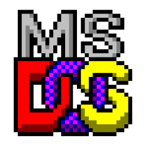

# MS-DOS 4.0 *modified*

[](https://github.com/ZacWalk/dos4z/actions/workflows/build.yml)

<p align="center">
  
</p>

This is a fork of the MS-DOS 4.00 source code as released by Microsoft. It has been modified to build on a modern Windows 11 machine using the *original* DOS build tools. Those tools are 16-bit, so they run under **demu**, the command-line runner of [libdos](https://github.com/ZacWalk/libdos), my DOS emulator library. I actively use this version of DOS on my retro PCs and I am slowly adding features I need — `VER` reports **4.0z** so you can tell it apart.

The main additions are support for large hard disks and CompactFlash cards (see
[Large disk support](docs/LARGE-DISKS.md)) and a set of bug fixes, listed under
[Changes from MS-DOS 4.00](#changes-from-ms-dos-400). Everything still runs on an 8088, so it
boots on an IBM PC 5150.

`make-dos.ps1` produces two bootable floppy images in `output/`, which you can boot in a PC emulator (86Box, PCem, DOSBox-X, VirtualBox, …) or write to real media.

## Requirements

- Windows 10/11 with Windows PowerShell 5.1 or PowerShell 7+
- Internet access for the first build, which downloads demu and dimg from a pinned
  [libdos release](https://github.com/ZacWalk/libdos/releases) and checks the zip's SHA-256

## Building

```powershell
.\make-dos.ps1                   # Build everything
.\make-dos.ps1 -Clean            # Clean rebuild
.\make-dos.ps1 -Component bios   # Build one component
.\make-dos.ps1 -Verbose          # Show full tool output
```

This uses demu to run the original DOS toolchain (NMAKE, MASM, LINK, CL, …) to compile the OS.
Components build in this order: `messages`, `mapper`, `boot`, `bios`, `dos`, `cmd`, `dev`,
`select`, `memm`, then `diskinfo`, the one new command, which libdos's C compiler builds. A
full build takes a few minutes.

demu and dimg are developed in [libdos](https://github.com/ZacWalk/libdos), where this build is
the test that every binary still comes out byte for byte the same. To build with a libdos
checkout instead of the release, build it there (`.\dd.ps1 build release`) and run:

```powershell
.\make-dos.ps1 -LibdosPath ..\libdos
```

### Build output

| Path | Contents |
|------|----------|
| `output/bin/` | Final DOS binaries (`io.sys`, `msdos.sys`, `command.com`, utilities, drivers) |
| `output/logs/` | Per-component build logs — first place to look when something fails |
| `output/msdos4-360.img` | 360 KB bootable floppy image with the essential utilities |
| `output/msdos4-1440.img` | 1.44 MB bootable floppy image with the full utility set |
| `output/demu.exe`, `output/dimg.exe` | The tools the build used, from libdos |

MS C 5.10 used to abort now and then with an internal compiler error in a random file under
the old demu. It has not happened since the build moved to libdos; if it does, run the build
again.

## Testing

```powershell
.\test-boot.ps1              # boot the build in libdos's emulated IBM PC and check it works
.\test-dosbox.ps1            # 2000 MB hard disk image (C: and D:), boot from C: in DOSBox
.\test-dosbox.ps1 -Floppy    # boot from msdos4-1440.img with the hard disk attached
```

`test-boot.ps1` boots the floppies and hard disk images in `demu --boot`, an emulated IBM PC
5150 with an 8088, and runs commands on them: CHS and LBA hard disks up to 24 drives, FDISK and
FORMAT on a blank disk, FAT layouts other systems make, DISKINFO, and a test program for the bug
fixes. It takes seconds, needs no window, and stops at any instruction an 8088 does not have;
CI runs it after every build. See
[Testing with demu --boot](docs/LARGE-DISKS.md#testing-with-demu---boot).

`test-dosbox.ps1` is for trying things by hand: it creates the disk image with `dimg` and starts
DOSBox 0.74-3 (or DOSBox-X with `-DosBox <path>`). See
[Testing in DOSBox](docs/LARGE-DISKS.md#testing-in-dosbox) for disk sizes, the LBA path and
doing it by hand.

## Changes from MS-DOS 4.00

### Large disks

IO.SYS uses the INT 13h extensions (LBA) when the BIOS provides them, finds logical drives
from the LBA fields of the partition tables, and accepts partition types 0Eh/0Fh. Each drive
is FAT16 and at most 2 GB, and a disk can have up to 24 drives (C: to Z:), so DOS can use
about 48 GB of a disk. FDISK and FORMAT handle partitions up to 2 GB; FDISK sees only the
first ~8 GB of a disk, and `dimg` sets up bigger CompactFlash cards on a PC. The new
`DISKINFO` command shows what a card's BIOS offers. The details, including card sizes, card
set-up and notes for the IBM PC 5150 with an XT-IDE / XT-CF card, are in
[docs/LARGE-DISKS.md](docs/LARGE-DISKS.md).

### Bug fixes

Most of these were found by E. C. Masloch while porting MS-DOS 4 to NASM for
[lDOS](https://hg.pushbx.org/ecm/msdos4/) and are applied here to the original sources.

| Component | Fix |
|-----------|-----|
| MSDOS.SYS | A write or truncate at a file position beyond cluster 65,535 dropped the high bits of the cluster number and corrupted the file; it now fails with "disk full" |
| MSDOS.SYS | INT 21h/5D00h (server call) with a function number above 6Ch jumped through a random address |
| MSDOS.SYS | EXEC's environment size check never fired (`DEC` does not set the carry flag) |
| MSDOS.SYS | EXEC could copy a long program name past the 8-byte name field of the memory control block |
| MSDOS.SYS | A search for the volume label could match a character device such as `CON` (fixed the same way in MS-DOS 5) |
| MSDOS.SYS | INT 21h/5F07h and 5F08h (enable/disable drive) and the "invalid drive" error code tested the offset instead of the segment of a drive's DPB pointer, so a DPB at offset 0 looked missing |
| MSDOS.SYS | INT 21h/47h (get current directory) returns `AX=0100h` like later versions |
| IO.SYS | A generic IOCTL with an unsupported minor code (for example 440Dh with `CX=0863h`) crashed the system |
| IO.SYS | Preparing a diskette format stored the new diskette parameter table in the wrong segment when the old table was not in segment 0 |
| IO.SYS | `DEVICE=`, `INSTALL=` or `SHELL=` with no file name stored a carriage return as the name, and with LF-only line endings swallowed the next CONFIG.SYS line |
| IO.SYS | CHS requests for cylinder 1024 wrapped round to cylinder 0; a BIOS geometry of 256 heads was stored as 0 |
| IO.SYS | Hard disk volumes formatted by another system were trusted only if their boot sector named MS-DOS, PC DOS or OS/2; others (Linux `mkfs.fat`, Windows 95, cameras) were assumed to have 1 reserved sector and 2 FATs, were read from the wrong sectors if they had not, and writing to them corrupted them |
| SHARE | INT 2Fh with `AH=10h` and an unknown subfunction hung the machine; it is now passed on |
| FDISK | Sizes were calculated in 16 bits and went wrong above 4 GB; partitions were not limited to what FAT16 can use; `/PRI`, `/EXT` and `/LOG` rejected sizes above 4000 MB |
| FORMAT | "Divide overflow" on partitions with more than 65,535 tracks or starting more than ~2 GB into the disk |

### Source and build fixes

- Release binaries that the build needs but an earlier `.gitignore` had dropped are restored:
  `COMSUBS.LIB`, `MEM.LIB`, `CASSFAR.LIB`, `SYSMAC.LIB`, the 4201/4208 printer `.CPI` files
  and `INDEXMAE.SYS`. MEM.EXE and SELECT now link against the real libraries instead of
  stubs.
- Box-drawing and other code page 437 characters that had been lost in SELECT and the
  message files are restored, following [hharte](https://github.com/hharte)'s fix, and three
  messages garbled by an encoding round trip (TREE, MEM) are repaired.
- `make-dos.ps1` fails when a component fails, and generated files are no longer committed.
- demu shortens file names to 8.3 as DOS does, so LINK writes `RAMDRIVE.MAP` instead of
  `RAMDRIVE.MAP-MAP` (a file that had been committed to make the build work).
- `dimg` makes partitioned hard disk images as well as floppies (`-hd`), and lists and copies
  files out of an image (`-dir`, `-extract`).
- demu and dimg moved to [libdos](https://github.com/ZacWalk/libdos), whose demu runs the
  toolchain as DOS would in a few more places, so `SELECT.HLP`, which `ASC2HLP` could never
  write before, is built too.

## Repository Layout

| Directory | Contents |
|-----------|----------|
| `dos/` | MS-DOS 4.0 source tree (renamed from the original `src/`) |
| `dos/BOOT/` | Boot sector |
| `dos/BIOS/` | IO.SYS — hardware abstraction layer |
| `dos/DOS/` | MSDOS.SYS — kernel (INT 21h API, FAT, memory, processes) |
| `dos/CMD/` | External commands (COMMAND.COM, FORMAT, DEBUG, FDISK, …) |
| `dos/DEV/` | Device drivers (ANSI.SYS, RAMDRIVE.SYS, …) |
| `dos/SELECT/` | Interactive installer |
| `dos/MEMM/` | EMM386 expanded memory manager (386 protected mode) |
| `dos/MAPPER/` | OS/2-to-DOS API mapping library |
| `dos/MESSAGES/` | Localised message database |
| `dos/INC/`, `dos/H/`, `dos/LIB/` | Shared includes, headers and libraries |
| `dos/TOOLS/` | Original 16-bit build tools (MASM, CL, LINK, NMAKE, …) |
| `docs/` | [Large disk support](docs/LARGE-DISKS.md), including how the build is tested |
| `tests/` | Test programs `test-boot.ps1` compiles with libdos's C compiler and runs on the booted DOS (`testfix.c`) |
| `output/` | Build artifacts, and demu and dimg from libdos (untracked) |

## Continuous Integration

[`.github/workflows/build.yml`](.github/workflows/build.yml) builds the whole OS, with demu and
dimg from the pinned libdos release, on `windows-latest` for every push and pull request
against `master`, then boots the result with `test-boot.ps1`.

## License

[MIT](LICENSE) — Copyright IBM and Microsoft Corporation.
